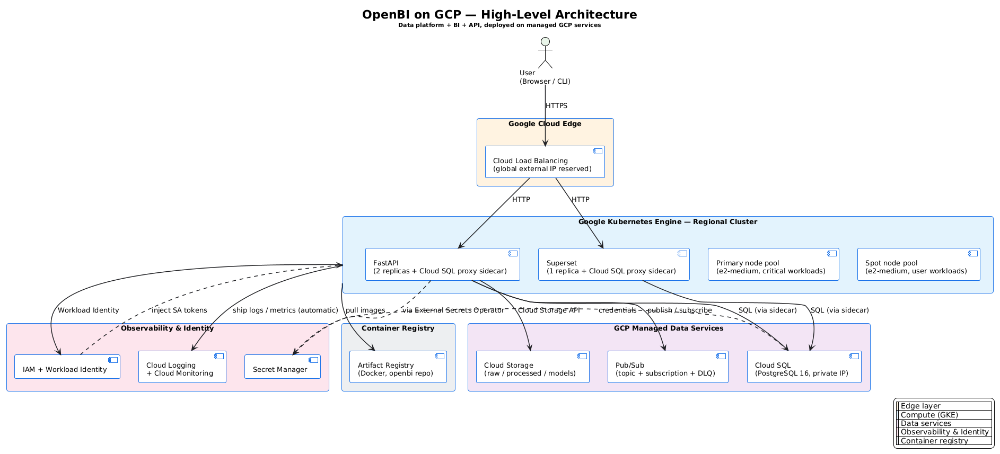

<div align="center">

# ☁️ OpenBI on GCP

### From Local Data Platform to Google Cloud Infrastructure

**Infrastructure as Code · Kubernetes · Data Engineering · Cloud Architecture**

[](https://github.com/adnanphp/openbi-gcp-cloud/actions/workflows/validate.yml)
[](LICENSE)
[](https://www.terraform.io/)
[](https://cloud.google.com/)
[](https://cloud.google.com/kubernetes-engine)

**Open-source cloud infrastructure configuration for [OpenBI](https://github.com/adnanphp/openbi).**

[Architecture](#-architecture) ·
[Technology Mapping](#-local-to-gcp-technology-mapping) ·
[Implementation](#-implementation-roadmap) ·
[Validation](#-verification-status) ·
[Getting Started](#-getting-started)

</div>

---

## 🌐 Overview

**OpenBI on GCP** is the Google Cloud infrastructure counterpart to the [OpenBI data platform](https://github.com/adnanphp/openbi).

The project explores how a locally developed Business Intelligence and data engineering platform can be prepared for deployment using Google Cloud managed services, Terraform, Kubernetes, and automated validation.

The infrastructure configuration covers networking, identity and access management, container infrastructure, object storage, relational databases, messaging, load balancing, observability, secrets, and application workloads.

The goal is to build a reproducible, documented, and cost-conscious cloud architecture without requiring a live GCP deployment during development and static validation.

### 🎯 Project objectives

- **Infrastructure as Code:** Define cloud infrastructure using Terraform.
- **Container orchestration:** Prepare application workloads for Google Kubernetes Engine (GKE).
- **Managed data services:** Configure cloud storage, PostgreSQL, and messaging integrations.
- **Security:** Include IAM, Workload Identity, private networking, and Secret Manager integration.
- **Observability:** Configure logging and monitoring integrations.
- **Automation:** Validate infrastructure configuration through GitHub Actions.
- **Documentation:** Maintain architecture, deployment, teardown, and troubleshooting guidance.
- **Cost awareness:** Develop and validate configuration before provisioning potentially billable resources.

---

## 🏗️ Architecture

The architecture connects OpenBI's local data platform concepts to corresponding Google Cloud services.

<div align="center">

### OpenBI on Google Cloud



*High-level architecture for the OpenBI GCP infrastructure configuration.*

</div>

**Architecture source files:**

- [PNG diagram](docs/diagrams/architecture-high-level.png)
- [SVG diagram](docs/diagrams/architecture-high-level.svg)
- [PlantUML source](docs/diagrams/architecture-high-level.puml)

The PlantUML source provides a text-based representation of the diagram, making the architecture easier to maintain and revise.

### Architecture layers

| Layer | Google Cloud components | Purpose |
|---|---|---|
| Networking | VPC, subnets, Cloud NAT, firewall rules | Network connectivity and traffic control |
| Identity | IAM, service accounts, Workload Identity | Service and workload access |
| Container infrastructure | GKE, Artifact Registry | Kubernetes workloads and container images |
| Object storage | Cloud Storage | Raw, processed, and model data |
| Relational database | Cloud SQL for PostgreSQL | Relational data storage |
| Messaging | Pub/Sub | Asynchronous messaging |
| Ingress | Cloud Load Balancing, GKE Ingress | Application traffic routing |
| Observability | Cloud Logging, Cloud Monitoring | Logs, metrics, and operational visibility |
| Secrets | Secret Manager | Centralized secret management |
| Application workloads | FastAPI, Superset, Cloud SQL Auth Proxy sidecar | API, analytics, and database connectivity |

> **Note:** This diagram represents the intended infrastructure architecture. It should not be interpreted as evidence of a running GCP deployment.

---

## 🔄 Local-to-GCP Technology Mapping

OpenBI already has a local development architecture. This repository explores how its components map to Google Cloud services.

| Local development component | GCP counterpart |
|---|---|
| Kind | Google Kubernetes Engine (GKE) |
| Traefik / AWS ALB patterns | Cloud Load Balancing + GKE Ingress |
| MinIO | Cloud Storage |
| Redis | Memorystore for Redis |
| Kafka | Pub/Sub |
| PostgreSQL | Cloud SQL for PostgreSQL |
| LocalStack | Google Cloud services |
| OpenFaaS | Cloud Run / Cloud Functions |
| Loki + Promtail | Cloud Logging |
| Prometheus | Cloud Monitoring |
| Docker images | Artifact Registry |
| Kubernetes Secrets | Secret Manager integration |

These are architectural mappings, not claims that every service is a drop-in replacement. Each integration has its own configuration, operational behavior, and limitations.

### Companion cloud project

| Repository | Focus |
|---|---|
| [OpenBI](https://github.com/adnanphp/openbi) | Core data platform |
| [OpenBI AWS Cloud](https://github.com/adnanphp/openbi-aws-cloud) | AWS infrastructure configuration |
| **OpenBI on GCP** | Google Cloud infrastructure configuration |

The AWS and GCP repositories explore different ways to prepare the same platform for managed cloud infrastructure.

---

## 🧰 Technology Stack

<div align="center">


</div>

| Category | Technologies |
|---|---|
| Infrastructure as Code | Terraform |
| Cloud platform | Google Cloud Platform |
| Container orchestration | Google Kubernetes Engine |
| Container registry | Artifact Registry |
| Storage | Cloud Storage |
| Database | Cloud SQL for PostgreSQL |
| Messaging | Pub/Sub |
| Networking | VPC, Cloud NAT, firewall rules, load balancing |
| Identity and security | IAM, service accounts, Workload Identity, Secret Manager |
| Observability | Cloud Logging, Cloud Monitoring |
| Application layer | Kubernetes, FastAPI, Superset |
| Automation | GitHub Actions, shell scripts |
| Supporting tools | Python, Docker, PlantUML |

---

## 🚀 Implementation Roadmap

The project is organized into implementation phases.

| Phase | Component | Scope |
|---|---|---|
| G1 | Networking | VPC, subnet ranges, Cloud NAT, firewall rules |
| G2 | Identity and access | GKE node service account and Workload Identity template |
| G3 | Artifact Registry | Docker repository and cleanup policy |
| G4 | GKE | Regional cluster, node pools, Workload Identity |
| G5 | Cloud Storage | Raw, processed, and models buckets with lifecycle policies |
| G6 | Cloud SQL | PostgreSQL, private IP, IAM authentication, backups |
| G7 | Pub/Sub | Topic, subscription, dead-letter queue |
| G8 | Load balancing | Reserved static IP and GKE Ingress examples |
| G9 | Observability and secrets | Logging, monitoring, Secret Manager integration |
| G10 | Application workloads | FastAPI, Superset, Cloud SQL proxy sidecar |
| G11 | Operations and documentation | Deployment, teardown, troubleshooting |

See [`ROADMAP.md`](ROADMAP.md) for the detailed roadmap.

---

## ✅ Verification Status

The repository includes infrastructure configuration, Kubernetes manifests, validation automation, and deployment documentation.

**The configuration is statically validated. It has not been deployed to a live GCP project.**

| Verification area | Status |
|---|---|
| Terraform syntax and schema | ✅ Reported as passing |
| Terraform formatting | ✅ Reported as passing |
| Terraform linting | ✅ Reported as passing |
| Infrastructure configuration | ✅ G1–G9 implemented |
| Kubernetes application manifests | ✅ G10 implemented |
| Deployment and teardown documentation | ✅ G11 implemented |
| Live GCP deployment | ⚠️ Not yet verified |
| End-to-end runtime behavior | ⚠️ Not yet verified |

The repository's GitHub Actions workflow provides automated configuration validation. A successful workflow does not, by itself, prove that cloud resources can be provisioned or that application workloads run successfully.

For details, see [`docs/verification.md`](docs/verification.md).

---

## 🛠️ Getting Started

### Prerequisites

For local configuration validation, install:

- Git
- Terraform
- TFLint
- The tools required by the repository's validation script

A GCP project and cloud credentials are not required for checks that validate configuration locally without provisioning resources.

### 1. Clone the repository

```bash
git clone https://github.com/adnanphp/openbi-gcp-cloud.git
cd openbi-gcp-cloud
```

### 2. Review the infrastructure

```bash
find terraform -maxdepth 4 -type f
```

Review the development environment and module configuration before making changes.

### 3. Run validation

```bash
./scripts/validate.sh
```

The validation script is the repository's primary local validation entry point.

Review its contents to confirm which checks it runs and which tools it expects to be installed.

### 4. Review the architecture

Start with:

- [`docs/diagrams/architecture-high-level.png`](docs/diagrams/architecture-high-level.png)
- [`docs/verification.md`](docs/verification.md)
- [`ROADMAP.md`](ROADMAP.md)

### 5. Deployment

Live deployment requires appropriate GCP configuration, credentials, permissions, and review of the infrastructure's potential costs.

**Do not run deployment commands against a real GCP project without reviewing the resources and expected charges first.**

See the repository's deployment and teardown documentation for the intended workflow.

---

## 💰 Cost-Conscious Development

Cloud infrastructure can incur charges even when an application is not actively serving traffic.

This project supports developing and validating configuration before provisioning resources.

Before any live deployment:

- Review GKE cluster and node-pool costs.
- Check Cloud SQL instance and storage costs.
- Review Cloud NAT, load balancer, and reserved IP charges.
- Inspect Cloud Storage retention and lifecycle policies.
- Confirm logging, monitoring, and networking costs.
- Review teardown procedures and resources that may persist after deletion.

Use the official [Google Cloud Pricing Calculator](https://cloud.google.com/products/calculator) to estimate costs for your intended region and configuration.

**The repository's validation workflow does not provision GCP infrastructure.** Always inspect the workflow and scripts before assuming a command is safe to run.

---

## 📁 Repository Structure

```text
openbi-gcp-cloud/
├── .github/
│   └── workflows/
│       └── validate.yml
├── docs/
│   ├── diagrams/
│   │   ├── architecture-high-level.png
│   │   ├── architecture-high-level.puml
│   │   └── architecture-high-level.svg
│   └── verification.md
├── kubernetes/
├── python/
├── scripts/
│   └── validate.sh
├── terraform/
│   ├── modules/
│   └── environments/
├── LICENSE
├── README.md
└── ROADMAP.md
```

*The tree highlights the principal project directories; individual files may vary as development continues.*

---

## 🔮 Future Directions

Potential future work includes:

- Testing infrastructure provisioning in a controlled GCP environment.
- Verifying Kubernetes workload startup and service connectivity.
- Testing application connectivity to Cloud SQL.
- Validating IAM and Workload Identity permissions in a live environment.
- Testing observability and secret-management integrations.
- Comparing AWS and GCP deployment architectures and operational trade-offs.
- Documenting measured deployment behavior and cost estimates.

These are future validation goals, not claims that live integration tests have already passed.

---

## 🤝 Related Projects

- **[OpenBI](https://github.com/adnanphp/openbi)** — Open-source Business Intelligence and data engineering platform.
- **[OpenBI AWS Cloud](https://github.com/adnanphp/openbi-aws-cloud)** — AWS infrastructure configuration for OpenBI.
- **[OpenBI on GCP](https://github.com/adnanphp/openbi-gcp-cloud)** — Google Cloud infrastructure configuration for OpenBI.

---

## 📄 License

This project is licensed under the [MIT License](LICENSE).

---

<div align="center">

**Built to explore cloud infrastructure, data engineering, and reproducible deployment workflows.**

⭐ If you find the project useful, consider starring the repository.

[OpenBI](https://github.com/adnanphp/openbi) ·
[OpenBI AWS Cloud](https://github.com/adnanphp/openbi-aws-cloud) ·
[OpenBI on GCP](https://github.com/adnanphp/openbi-gcp-cloud)

</div>
